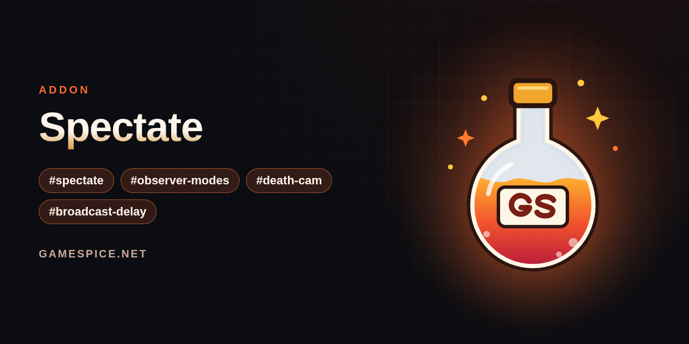

[](https://moddingcommunity.com/a/252-dot-spectate)

Decides who a player may watch, which camera they get and where it goes, for when they die or have not joined a side. It gives you a `Transform3D` (or a 2D position and angle); your game puts its camera there.

A spectator view is an easy way to cheat, so the server decides:

- **Who may be watched.** `force_camera` is `0` for everybody, `1` for own team only (and first person only, since a chase camera sees round corners) or `2` for nobody (only the map's fixed cameras), matching the `mp_forcecamera` cvar.
- **How late the picture is.** `delay_ticks` shows the past, so a spectator is not watching live.

A dead player gets a short death cam where they fell, a freeze cam on their killer, then first person on a teammate. If the target dies or leaves, they move to somebody else.

## Install

1. Get [Godot 4.7](https://godotengine.org/download).
2. Either use [dot-bootstrap](https://github.com/gamespice-platform/bootstrap), which clones every project and links the addons, or copy `addons/dot_spectate/` and [dot-core](https://github.com/gamespice-platform/core)'s `addons/dot_core/` into your project and enable dot-spectate in *Project > Project Settings > Plugins*.

dot-core is the only dependency.

## Use

```gdscript
var spectate := DotSpectatorManager.new()
spectate.participants_fn = roster.keys        # () -> PackedStringArray
spectate.team_fn = match_node.team_of         # (key) -> int
spectate.alive_fn = world.is_alive            # (key) -> bool
spectate.pose_fn = world.eye_transform_of     # (key) -> Transform3D, the eyes and not the feet
spectate.setup()
add_child(spectate)

spectate.on_death("ada", where_they_fell, "bob", tick)   # starts the death cam chain
spectate.on_spawn("ada")                                 # back to playing
spectate.on_leave("ada")                                 # after the roster has dropped them

spectate.advance(tick)                                   # once a tick
camera.global_transform = spectate.camera_of(me)         # once a frame
```

Or subclass `DotSpectatorHost`, which builds the manager and forwards the calls: override `_participants`, `_team_of`, `_is_alive`, `_pose_of` and `_current_tick`. A 2D game uses `camera_2d_of(me)`.

| Call | Does |
| --- | --- |
| `next_target(me)`, `previous_target(me)` | Cycle targets. |
| `set_mode(me, DotSpectatorView.Mode.CHASE)` | Change camera. A mode the rules forbid becomes one they allow. |
| `targets_for(me)`, `may_watch(me, them)` | Build a name list the server will accept. |
| `target_filter` | Your own `(viewer, target) -> bool` rule. |
| `to_wire(key)`, `apply_wire()` | Server sends each viewer their view; the client manager (`authoritative = false`) loads it. |

Modes: `FIRST_PERSON`, `CHASE`, `FIXED`, `ROAMING` (`move_free()`), `DEATH_CAM`, `FREEZE_CAM`. Signals: `view_changed`, `retargeted`, `timed_out`.

## Settings

Rules live in a `DotSpectatorRules` resource on the manager's `rules`, layered like every GameSpice config: inspector defaults, JSON file, environment, command line. Call `load_layered()` before `setup()`.

```gdscript
var rules := DotSpectatorRules.new()
rules.load_layered("user://spectate.json")
spectate.rules = rules
```

Example: `GS_SPECTATE_FORCE_CAMERA=0 <your server> --spectate-delay-ticks=640`.

| Setting | Default | What it does |
| --- | --- | --- |
| `force_camera` | 0 | 0 everybody, 1 own team (first person only), 2 nobody. |
| `allow_while_dead` | true | A dead player may spectate before the round ends. |
| `allow_unassigned` | true | A player on no team may spectate. |
| `allow_while_alive` | false | A living player may spectate (replay viewers). |
| `allow_roaming` | true | Offer a free camera. Only effective with `force_camera` 0. |
| `roam_speed` | 12 | Free camera metres per second. `roam_fast_scale` 3 and `roam_slow_scale` 0.25 are the modifier keys. |
| `death_cam_ticks` | 128 | How long the death cam holds. |
| `freeze_cam_ticks` | 192 | How long the freeze cam holds on the killer. 0 skips it. |
| `chase_distance`, `chase_height` | 3.5, 0.8 | Chase camera offset behind and above the target. |
| `auto_retarget` | true | Move a spectator on when their target dies or leaves. |
| `cycle_includes_dead` | false | Dead players are in the cycle. |
| `delay_ticks` | 0 | How far behind live the camera is. 0 is live. |
| `history_ticks` | 128 | Pose history kept. Raised to `delay_ticks + 1` if lower. |

## Testing

Import the project once, then run `examples/spectate_selftest.tscn` headless with Godot.

## Status and licence

Part of the [**GameSpice**](https://gamespice.net) platform: a family of Godot addons. Written with Claude Code and maintained by `gamemann`. Every addon has headless tests, but little of this has been played by real users yet, so expect rough edges and please [open an issue](https://github.com/gamespice-platform/spectate/issues) when you hit one.

MIT licence, see [LICENSE](LICENSE). The only closed part of the [**GameSpice**](https://gamespice.net) platform is the web back end; you can use your own instead of GameSpice's.
